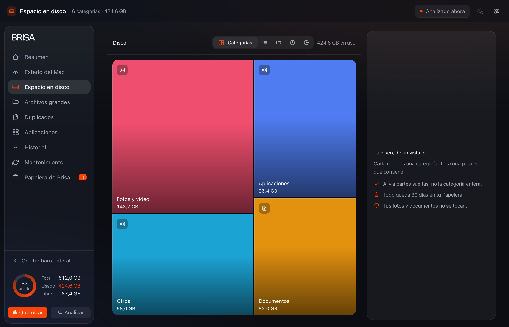
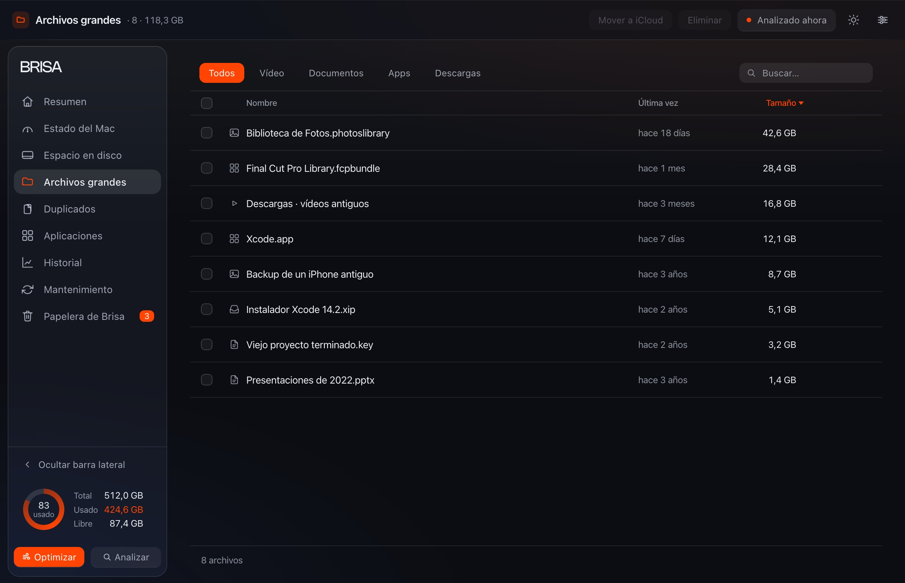
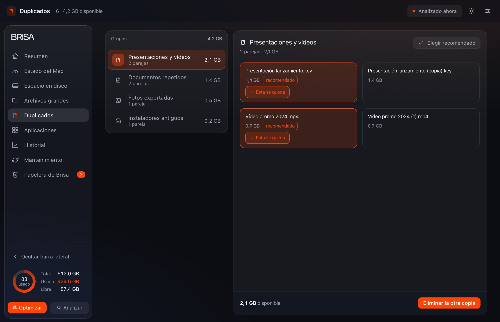
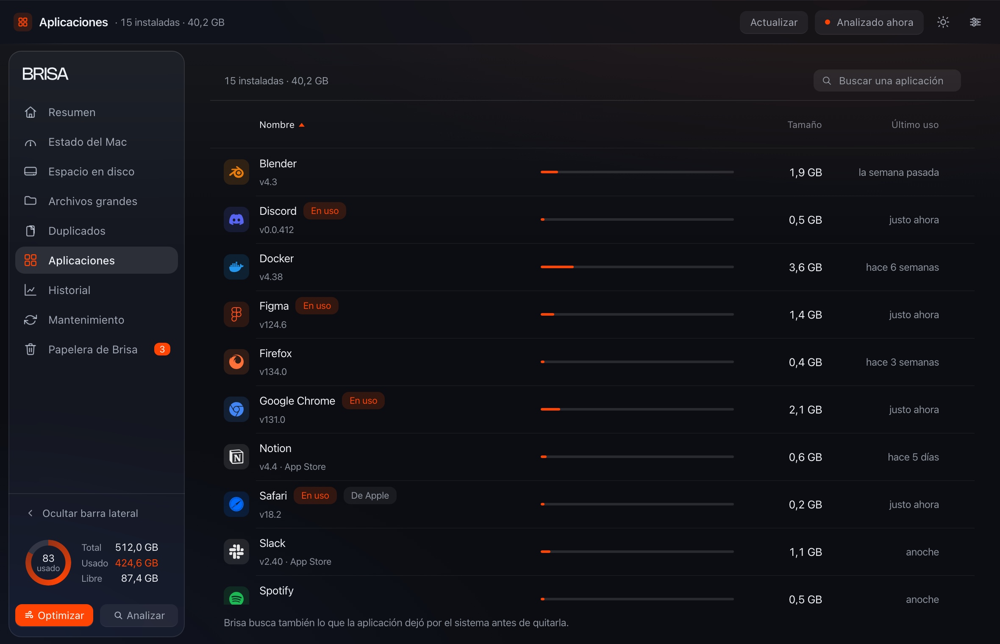
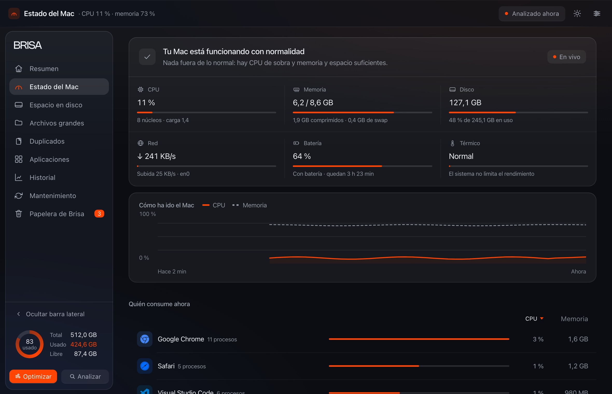
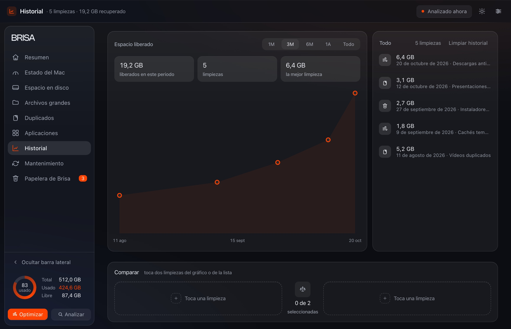

<p align="center">
  
</p>

<h1 align="center">Brisa</h1>

<p align="center">
  <strong>Limpia tu Mac sin miedo a borrar.</strong><br>
  Analiza el disco, enseña qué va a quitar y lo aparta en una papelera propia.<br>
  Todo lo que quita vuelve a su sitio durante 7, 30 o 60 días.
</p>

<p align="center">
  <a href="https://heybrisa.pages.dev/descarga"></a>
  
  
  
  
</p>


---

## Qué es

Brisa es una aplicación nativa para macOS que responde a una sola pregunta: **qué ocupa mi disco y qué puedo tocar sin arrepentirme**.

Mide el disco por categorías, encuentra los archivos grandes, agrupa los duplicados, desinstala aplicaciones con lo que dejaron repartido por el sistema y limpia cachés con reglas que se pueden apagar una a una. Nada se elimina al limpiar: cada cosa pasa por la **Papelera de Brisa**, espera con su fecha de caducidad y vuelve a su ruta exacta si la reclamas.

No hay cuenta, no hay suscripción y no hay una sola conexión de red en el código.

---

## Nueve vistas, una para cada tarea

Cada pantalla hace una cosa. Ninguna hace dos.

<table>
  <tr>
    <td width="33%" align="center"><br><sub><b>Espacio en disco</b><br>Qué ocupa cada cosa</sub></td>
    <td width="33%" align="center"><br><sub><b>Archivos grandes</b><br>Lo más pesado, primero</sub></td>
    <td width="33%" align="center"><br><sub><b>Duplicados</b><br>Cada grupo, con su razón</sub></td>
  </tr>
  <tr>
    <td align="center"><br><sub><b>Aplicaciones</b><br>Con su rastro completo</sub></td>
    <td align="center"><br><sub><b>Estado del Mac</b><br>CPU, memoria, disco, sensores</sub></td>
    <td align="center"><br><sub><b>Historial</b><br>Todo lo que ha pasado</sub></td>
  </tr>
  <tr>
    <td align="center"><br><sub><b>Mantenimiento</b><br>Limpieza desatendida, opcional</sub></td>
    <td align="center"><br><sub><b>Papelera de Brisa</b><br>Con deshacer y caducidad</sub></td>
    <td align="center"><br><sub><b>Resumen</b><br>Dónde empieza todo</sub></td>
  </tr>
</table>

---

## La reversibilidad no es un ajuste: es el mecanismo

1. **Retira, no borra.** El archivo sale de su carpeta y entra en la Papelera de Brisa. En ese paso no se elimina nada.
2. **Espera contigo.** Se queda 7, 30 o 60 días —lo eliges tú—, con su fecha de caducidad a la vista y su tamaño al lado.
3. **Vuelve a su ruta.** Un clic y regresa exactamente donde estaba. Cumplido el plazo, la papelera se vacía sola.

La desinstalación de aplicaciones es la única operación definitiva, y la app lo dice antes de empezar. Todo lo demás se puede deshacer.

---

## Sin red, sin cuenta, sin letra pequeña

| | |
|---|---|
| **No abre ninguna conexión.** | Ni cuentas, ni analítica, ni actualizaciones que llamen a casa. No hay una sola llamada de red en `Sources/`. El análisis ocurre entero en tu Mac. |
| **Un permiso, y opcional.** | Brisa no pide nada al abrirse. Sin *Acceso total al disco* mide todo lo demás y lo dice en el Resumen. Si prefieres no darlo, sirve igual. |
| **Los datos se quedan aquí.** | Papelera, historial, exclusiones y el histórico del Mac —una muestra cada diez segundos, 24 horas— en `~/Library/Application Support/Brisa/`. |

---

## Requisitos e instalación

- **macOS 14 Sonoma** o posterior.
- 490 KB. Gratis, sin cuenta.
- Descarga: **[heybrisa.pages.dev/descarga](https://heybrisa.pages.dev/descarga)** (también en [`web/descargas/Brisa-0.2.0-beta.dmg`](web/descargas/Brisa-0.2.0-beta.dmg)).

La beta se firma **ad-hoc**, no está notarizada por Apple, así que macOS avisará la primera vez. Es lo que hay en la 0.2.0 y no se esconde: la guía de primer arranque —[`Docs/GUIA-PRIMER-ARRANQUE.txt`](Docs/GUIA-PRIMER-ARRANQUE.txt)— explica el paso, que se resuelve en *Ajustes › Privacidad y seguridad › Abrir igualmente*.

Para desinstalarla del todo:

```bash
/Applications/Brisa.app/Contents/MacOS/Brisa --reset
rm -rf /Applications/Brisa.app
```

---

## Cómo está hecho

**La app** es Swift 5.9 sobre SwiftPM, sin una sola dependencia externa. La interfaz vive en un `WKWebView` y habla con el sistema por un puente propio (`JSBridge`), así que la ventana es nativa —semáforos, arrastre, menús— y el dibujo es HTML y CSS. La interfaz se edita **solo** en `Sources/brisa_app/Resources/index.html`, fuente única de la app y del prototipo navegable; `Scripts/publicar.py` genera las copias publicadas, recorta comentarios (−29 % de peso) y comprueba que no se pierde nada.

**La web** —[heybrisa.pages.dev](https://heybrisa.pages.dev)— son 20 páginas en español e inglés construidas con la biblioteca estándar de Python. `web/build.py` compone las plantillas, resuelve el diccionario de textos y genera las capturas en AVIF; `web/verificar-sitio.py` comprueba que lo publicado coincide con su fuente —contraste, enlaces, cabeceras, datos estructurados, mapas del sitio— antes de cada commit, porque el repositorio no tiene CI y el gancho `.githooks/pre-commit` hace de ella.

Tampoco hay build step de JavaScript, ni framework, ni CDN: el sitio pesa 231 KB con las tres capturas de la portada.

---

## Estructura

```
brisa-mac/
├── Package.swift                 SwiftPM · macOS 14+ · sin dependencias
├── Sources/brisa_app/            Swift, una responsabilidad por archivo
│   └── Resources/index.html      La interfaz: fuente única de app y prototipo
├── Tests/                        Verificadores de lógica (swiftc, standalone)
├── Scripts/                      Publicador, verificador, icono y DMG
├── web/                          El sitio: plantillas, estilos, textos y capturas
│   ├── build.py                  Construye las 20 páginas
│   ├── verificar-sitio.py        Las comprueba antes de publicar
│   └── tools/                    Tarjetas, capturas y vigilancia del sitio
├── Docs/                         Guía de primer arranque y mensaje de beta
├── marketing/                    Material de presentación
└── build-app.sh                  → dist/Brisa.app, firmada ad-hoc
```

---

## Compilar, verificar y empaquetar

```bash
# la app
swift build -c debug
bash build-app.sh                    # → dist/Brisa.app
bash Scripts/make-dmg.sh             # → dist/Brisa-0.2.0-beta.dmg

# la interfaz y el sitio
python3 Scripts/verificar-interfaz.py   # sintaxis JS, i18n, iconos, contraste
python3 web/build.py                    # → 20 páginas
python3 web/verificar-sitio.py          # 18 comprobaciones sobre lo construido
```

Los verificadores de `Tests/` se compilan contra las fuentes reales de lógica, cada uno con su propio `@main`:

```bash
SDK=$(ls -d /Library/Developer/CommandLineTools/SDKs/MacOSX26*.sdk | tail -1)
LOGIC=$(ls Sources/brisa_app/*.swift | \
  grep -vE '/(main|BrisaApp|BrisaView|BrisaViewHost|AppDelegate|JSBridge|WindowConfigurator|DesktopPreferences)\.swift')
for t in Tests/verify_*.swift; do
  swiftc -parse-as-library -sdk "$SDK" $LOGIC "$t" -o /tmp/v && /tmp/v || echo "FALLA: $t"
done
```

---

## Licencia

Brisa se reparte **gratis**: puedes instalarla en los Mac que quieras y pasar el instalador tal cual a quien quiera probarla. No se concede modificarla, descompilarla, revenderla ni repartirla como parte de otro producto. Es una beta: puede cambiar sin aviso y no promete soporte. Los términos completos están en [heybrisa.pages.dev/licencia](https://heybrisa.pages.dev/licencia).

El código se publica para poder leerlo, comprobarlo y aprender de él.

---

## In English

Brisa is a native macOS disk cleaner built around one idea: **removal is reversible**. Everything it takes goes into its own trash for 7, 30 or 60 days and comes back to its exact path on a click. No account, no subscription, no network code at all — the scan runs entirely on your Mac. Swift 5.9 with zero dependencies, UI in a WKWebView, bilingual (Spanish/English). Beta 0.2.0, ad-hoc signed, macOS 14+.

---

<p align="center"><sub>Hecho por <a href="https://github.com/OddXandre">OddXandre</a> · <a href="https://heybrisa.pages.dev">heybrisa.pages.dev</a></sub></p>
