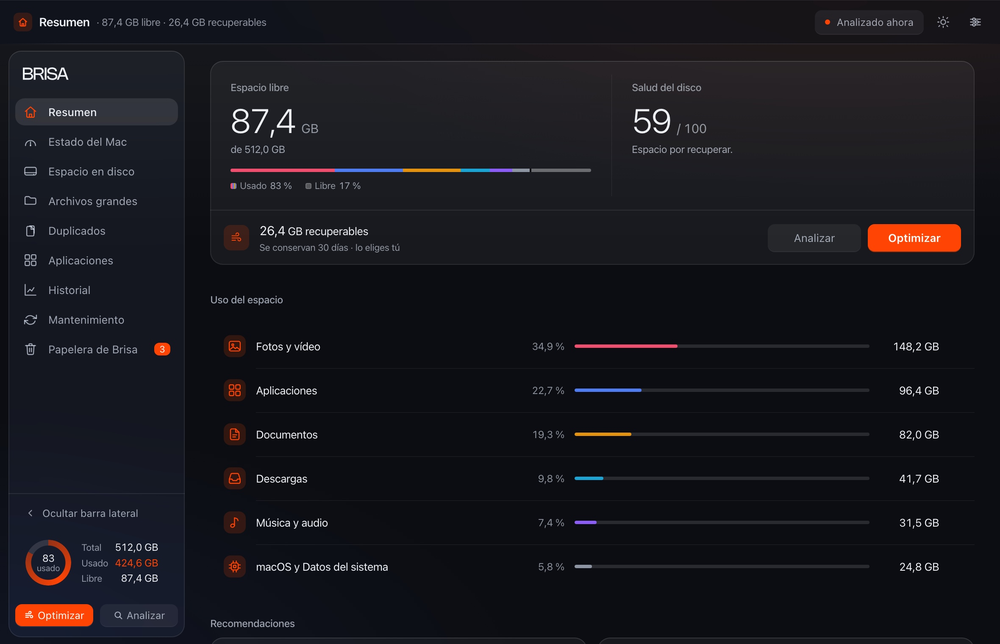
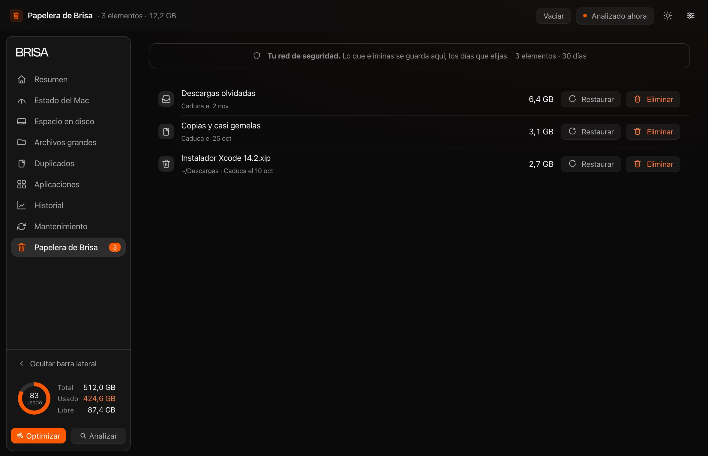

<p align="center"></p>

<h1 align="center">Brisa</h1>

<p align="center">
  Limpia tu Mac sin miedo a borrar.<br>
  <sub>Nada se elimina: se aparta, y vuelve.</sub>
</p>

<p align="center">
  <sub>macOS 14+ · Swift 5.9 · sin dependencias · sin red</sub>
</p>

<p align="center">
  <a href="https://heybrisa.pages.dev/descarga"><b>Descargar</b></a> ·
  <a href="https://heybrisa.pages.dev">heybrisa.pages.dev</a>
</p>



## Qué es

Brisa mide tu disco, enseña qué ocupa cada cosa y aparta lo que ya no quieres.
Ninguna limpieza borra: todo pasa por su propia papelera y vuelve a su ruta
exacta durante 7, 30 o 60 días. Sin cuenta, sin red, sin permisos de más.



## Cómo funciona

**Retira.** El archivo sale de su carpeta y entra en la Papelera de Brisa.
**Espera.** Se queda con su fecha de caducidad a la vista.
**Vuelve.** Un clic y regresa donde estaba. Cumplido el plazo, se vacía sola.

Nueve vistas, una para cada tarea: [heybrisa.pages.dev/herramientas](https://heybrisa.pages.dev/herramientas)

## Instalar

macOS 14 o posterior · 490 KB · [descargar](https://heybrisa.pages.dev/descarga)

```bash
curl -LO https://heybrisa.pages.dev/descargas/Brisa-0.2.0-beta.dmg
```

La beta va firmada ad-hoc, no notarizada, así que macOS avisará la primera vez.
La [guía de primer arranque](Docs/GUIA-PRIMER-ARRANQUE.txt) explica ese paso.

## Compilar

```bash
swift build -c debug
bash build-app.sh                 # → dist/Brisa.app
bash Scripts/make-dmg.sh          # → dist/Brisa-0.2.0-beta.dmg

python3 web/build.py              # las 20 páginas del sitio
python3 web/verificar-sitio.py    # y su comprobación
```

## Privacidad

Ni cuentas, ni analítica, ni una sola conexión de red en `Sources/`. El análisis
ocurre entero en tu Mac y los datos viven en `~/Library/Application Support/Brisa/`.

## Licencia

Gratis para instalar y usar. [Términos completos](https://heybrisa.pages.dev/licencia).

<sub>Hecho por [OddXandre](https://github.com/OddXandre)</sub>
